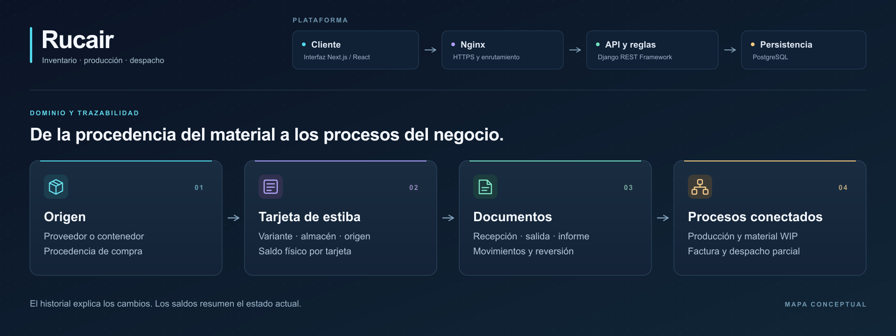

# Rucair · arquitectura y decisiones de diseño

**Caso de estudio de una aplicación web de inventario, producción y despacho.** Esta documentación presenta el diseño observado en un proyecto privado. Permite evaluar sus decisiones técnicas sin publicar código fuente, configuración sensible ni datos de operación.

[Portada editable en SVG](assets/portada-rucair-horizontal.svg) · [Mapa general en fondo claro](assets/mapa-rucair.svg)

## En un minuto

| El problema | La solución | El reto técnico |
| --- | --- | --- |
| Una cantidad total no explica dónde está el material, de qué compra procede ni qué operación la cambió. | Tarjetas de estiba por variante y almacén, vinculadas a procedencia y movimientos documentados. | Mantener coherentes historial, saldo por tarjeta y saldo agregado del almacén. |
| El material extraído y la mercancía comprometida afectan decisiones antes de salir definitivamente del sistema. | Órdenes con asignaciones de material en proceso; facturas con conduces parciales y análisis de pendientes. | Distinguir stock físico, compromisos informativos y cantidades efectivamente despachadas. |

El proyecto empezó con tarjetas de estiba y movimientos sin las restricciones que llegaron después. Un requisito posterior exigió diferenciar los lotes por origen de compra —proveedor o contenedor—. Las solicitudes siguientes conectaron inventario con documentos, producción, facturación y paneles de análisis. [Lee la evolución y sus límites](docs/09-evolucion-y-decisiones.md).

## Elige una ruta de lectura

**Lectura rápida · 5 minutos:** [Contexto](docs/01-contexto-y-alcance.md) → [Arquitectura general](docs/03-arquitectura-general.md) → [Decisiones y límites](docs/09-evolucion-y-decisiones.md).

**Revisión técnica:** [Requisitos y reglas](docs/02-requisitos-y-reglas.md) → [Modelo de datos](docs/06-modelo-de-datos.md) → [Flujos de negocio](docs/07-flujos-de-negocio.md) → [Backend](docs/04-backend.md) → [Frontend](docs/05-frontend.md) → [Despliegue y calidad](docs/08-despliegue-y-calidad.md).

## Cuatro decisiones que definen el sistema

1. **La tarjeta es la unidad de seguimiento físico.** Identifica una variante en un almacén y puede conservar su procedencia. El origen no es, por sí solo, una clave única de lote.
2. **Documento y movimiento cumplen funciones distintas.** El documento justifica la operación; el movimiento registra cómo cambió el inventario y cuál quedó como saldo posterior.
3. **Los saldos se materializan para consultar rápido.** El historial sirve para auditoría; los resúmenes por tarjeta y almacén requieren actualización consistente en cada flujo y cancelación.
4. **La disponibilidad del panel es informativa.** Los compromisos de producción y factura se calculan por variante, sin asignarse de forma persistente a un lote concreto.

## Guía completa

**Aprendizaje del desarrollo:** al crecer el frontend, la organización por tipo de archivo dispersó las piezas de cada funcionalidad. El autor explica por qué elegiría módulos que reúnan sus componentes, servicios, esquemas y estado para un próximo proyecto. [Leer la decisión y sus compromisos](docs/10-decision-frontend-por-modulos.md).

| Tema | Qué encontrarás |
| --- | --- |
| [Contexto y alcance](docs/01-contexto-y-alcance.md) | Problema, evolución y alcance funcional. |
| [Requisitos y reglas](docs/02-requisitos-y-reglas.md) | Capacidades, validaciones y límites de las reservas. |
| [Arquitectura general](docs/03-arquitectura-general.md) | Componentes, responsabilidades y recorrido de una operación. |
| [Backend](docs/04-backend.md) | Arquitectura modular, patrones observados, ventajas y costes. |
| [Frontend](docs/05-frontend.md) | Organización actual, patrones, estado y retos de mantenimiento. |
| [Modelo de datos](docs/06-modelo-de-datos.md) | Entidades, relaciones y saldos. |
| [Flujos de negocio](docs/07-flujos-de-negocio.md) | Recepción, producción, despacho y cancelación. |
| [Despliegue y calidad](docs/08-despliegue-y-calidad.md) | Nginx, contenedores, CI, backup y pruebas. |
| [Evolución y decisiones](docs/09-evolucion-y-decisiones.md) | Cambios de alcance, compromisos y preguntas abiertas. |
| [Decisión: frontend por módulos](docs/10-decision-frontend-por-modulos.md) | Experiencia del autor, estructura propuesta y reglas de dependencia. |

## Alcance de la evidencia

La documentación inicial se elaboró a partir del proyecto consultado el **12 de octubre de 2026**. Los capítulos de backend y frontend se ampliaron el **15 de octubre de 2026**, contrastando patrones con el código e incorporando la experiencia del autor. «Implementado» significa constatado en modelos, servicios, rutas o configuración. Una regla validada en un flujo no implica una restricción equivalente en la base de datos. Las inferencias y propuestas se señalan en el texto. No se verificó una instancia de producción ni se utilizaron datos reales.

El directorio está preparado para publicarse por separado. No contiene dominio, valores de variables de entorno, nombres de clientes o proveedores, registros, capturas, claves ni código fuente de la aplicación. Los diagramas son conceptuales. Antes de publicarlo, corresponde revisar el contenido según los acuerdos de confidencialidad aplicables.
