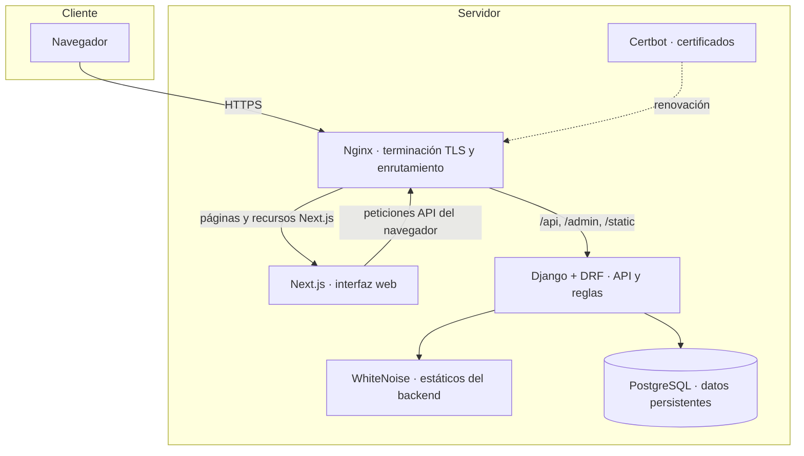
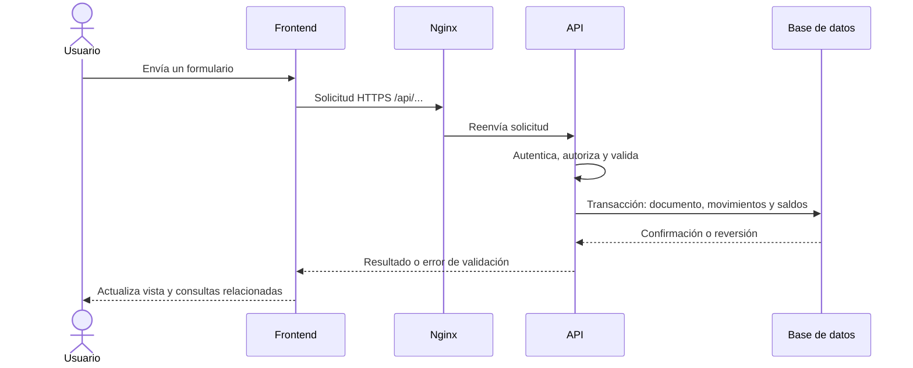

# 3. Arquitectura general

## Componentes

La aplicación se compone de un frontend Next.js/React, una API Django REST Framework y una base PostgreSQL. En el despliegue definido por Docker Compose, Nginx publica HTTP/HTTPS, redirige HTTP a HTTPS y enruta la API, el administrador y los estáticos del backend hacia Django; el resto va a Next.js. Gunicorn sirve Django. WhiteNoise sirve los estáticos recolectados del backend. Certbot obtiene y renueva certificados.

## Límites de responsabilidad

- **Navegador / frontend:** navegación, formularios, validación de entrada para la experiencia de usuario, filtros, tablas, gráficos, estado de sesión y presentación de errores.
- **API / servicios:** autenticación, autorización, validaciones de negocio, creación y cancelación de documentos, actualización de saldos, reglas de producción y despacho.
- **Base de datos:** relaciones, historial de operaciones, saldos persistidos y restricciones declaradas por el modelo. PostgreSQL es el motor de la configuración de producción revisada; SQLite se usa como alternativa local y en pruebas.
- **Proxy:** acceso desde un único dominio, TLS y separación de rutas públicas. La URL de la API que recibe el navegador se incorpora al frontend durante su compilación.

## Recorrido de una operación

Las operaciones de escritura relevantes agrupan varios cambios bajo transacciones de Django. Esto evita dejar un documento creado sin los movimientos o saldos esperados si la operación falla a mitad. Algunos servicios usan bloqueo de filas (`select_for_update`) para serializar modificaciones concurrentes sobre saldos o líneas de factura. La cobertura exacta de concurrencia depende de cada flujo; no se presupone una garantía global para todas las escrituras.

## Estilo arquitectónico

El backend está organizado por dominios funcionales: administración, productos, almacenes, inventario, documentos, producción, facturación y analítica. Los endpoints reciben datos y delegan parte de la lógica en servicios. Los modelos incorporan algunas validaciones y estados derivados; las señales sincronizan las cantidades despachadas y el estado de facturas cuando cambian documentos de despacho. Este diseño combina separación modular con reglas que cruzan módulos: por ejemplo, una salida de producción toca documento, tarjeta, saldo de almacén y asignación WIP.

La analítica es principalmente de lectura. Consulta modelos operativos y saldos resumidos, aplica filtros y devuelve métricas para el panel. No existe en la configuración revisada un almacén analítico separado.

## Entornos definidos

La configuración de producción usa contenedores separados para PostgreSQL, Django, Next.js, Nginx y Certbot. Hay un modo de prueba local sin Internet para Windows que usa SQLite y arranca backend y frontend sin Docker. Las instrucciones internas de despliegue describen un VPS y CI/CD; esta documentación presenta la **topología definida**, no afirma que un entorno concreto esté actualmente activo.
