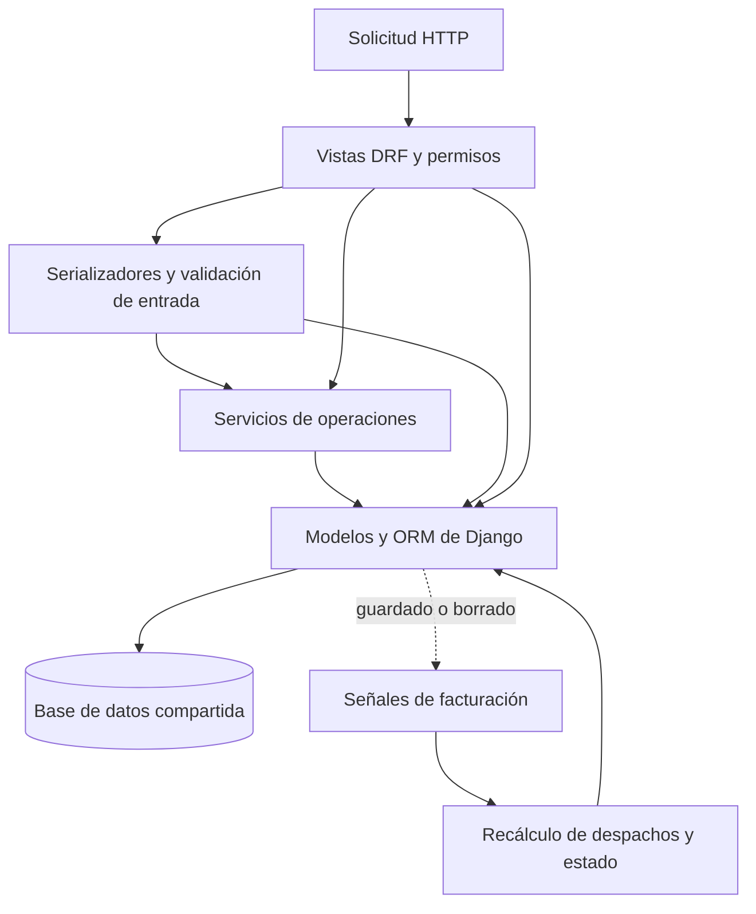

# 4. Backend

## Base técnica

El servidor está implementado con Python, Django 5.1 y Django REST Framework. Usa JWT mediante SimpleJWT, filtros de Django Filter, esquema OpenAPI con drf-spectacular, Gunicorn como servidor WSGI y WhiteNoise para estáticos. django-auditlog figura en la configuración, pero su presencia no demuestra por sí sola cobertura de auditoría para todos los modelos. Las dependencias se fijan en el proyecto privado; aquí se indican componentes para explicar la arquitectura, no como instrucciones de instalación.

## Clasificación y fundamento de la arquitectura

El backend es una **aplicación monolítica organizada en módulos de negocio, con capas de API, servicios y persistencia**. Las aplicaciones de Django agrupan administración, inventario, producción y otros dominios dentro de un mismo despliegue del backend y una base de datos compartida. La modularidad es organizativa: los servicios importan modelos de otros módulos y no se observan fronteras estrictas de dependencia entre todas las aplicaciones.

Esta clasificación se deduce del código; no implica que el autor haya elegido formalmente un estilo arquitectónico con ese nombre al comenzar. Django aporta su organización de modelos, vistas y plantillas, pero la interfaz principal está en Next.js. Para explicar este proyecto resulta más preciso describir la API de DRF y los servicios que llamarlo únicamente MVC o MVT.

La estructura encaja con operaciones que deben cambiar varios registros de forma coordinada. Un despacho relaciona factura, línea de documento, movimiento y saldos. Ejecutar esa operación dentro de un proceso y una base permite utilizar una transacción local. El coste es que los módulos comparten despliegue, esquema y dependencias, por lo que algunos cambios requieren revisar varios dominios.

El diagrama incluye accesos al ORM desde vistas y serializadores porque existen en el proyecto. La capa de servicios no es una barrera obligatoria para toda operación. Las dependencias reales importan más que la presencia de una carpeta llamada `services`.

## Organización por módulos

| Módulo | Responsabilidad principal |
| --- | --- |
| Administración | Usuario propio, roles, inicio y cierre de sesión, gestión de usuarios. |
| Productos | Productos, categoría, unidad y variantes con atributos JSON. |
| Almacenes | Ubicaciones y saldo agregado por variante y almacén. |
| Inventario | Orígenes, tarjetas, movimientos, saldos de tarjeta, cancelaciones. |
| Documentos | Recepciones, salidas, mermas, ajustes, devoluciones, informes y conduces. |
| Producción | Órdenes, objetivo, requisitos y asignaciones de material en proceso. |
| Facturación | Clientes, facturas, líneas y cantidades despachadas. |
| Analítica | Lecturas y agregaciones para inventario, producción y facturación. |

Cada módulo expone rutas bajo `/api/` y combina vistas/serializadores con modelos. Los servicios concentran operaciones con varios cambios de estado. Esta división mantiene las operaciones cerca del dominio que las inicia, aunque una operación puede necesitar modelos de otros módulos.

## Superficie de API

Las familias de rutas son `/api/administration/`, `/api/products/`, `/api/warehouses/`, `/api/inventory/`, `/api/documents/`, `/api/production/`, `/api/invoicing/` y `/api/analytics/`. Predominan los `ViewSet` de DRF con acciones específicas: cancelar documentos o movimientos, consultar disponibilidad WIP, obtener pendientes de una factura y listar sus conduces. La analítica usa endpoints de solo lectura para catálogos, inventario, reservas, producción, facturación y detalle de series. El proyecto define esquema OpenAPI y dos vistas de exploración del mismo.

Esta descripción es deliberadamente de alto nivel; el contrato completo de peticiones y respuestas debe generarse desde el esquema de la versión privada que se vaya a desplegar.

## Autenticación y autorización

El inicio de sesión devuelve un token de acceso y guarda el token de renovación en una cookie `HttpOnly`. Una segunda cookie almacena el rol para orientar las redirecciones del frontend. El navegador envía el acceso como `Bearer`; si vence, el cliente llama al endpoint de renovación usando la cookie. La API también tiene clases de autenticación de sesión y básica configuradas en DRF.

La clase de permiso global exige usuario autenticado y decide acceso según método y rol. Varias vistas declaran permisos propios; por ello, la política efectiva se debe evaluar por endpoint. La cookie de rol del frontend no es autoridad para las escrituras. La configuración de producción activa cookies seguras, redirección a HTTPS, HSTS y cabeceras de seguridad.

## Integridad y consistencia

- Los servicios de documentos crean cabecera, líneas, movimientos y saldos dentro de transacciones en los flujos revisados.
- El historial de `StockMovement` registra el cambio y el saldo posterior; una cancelación lo marca como revertido y ajusta los saldos según el tipo de operación.
- `StockCardBalance` y `ProductWarehouseBalance` son saldos materializados para lectura. Deben permanecer coherentes con los movimientos válidos. El panel puede señalar diferencias como alerta; no las corrige automáticamente.
- `InvoiceItem.quantity_dispatched` es un agregado persistido. Señales sobre líneas y documentos de despacho recalculan ese campo y el estado de la factura.
- Las validaciones de modelo y servicio protegen relaciones como factura ↔ conduce ↔ variante. Los constraints de la base cubren solo parte de las reglas.

## Lectura analítica

El panel calcula métricas agrupando por variante y unidad. Para evitar multiplicación de resultados por joins múltiples, el inventario analítico realiza agregaciones separadas de saldos, requisitos, facturas y WIP, y luego compone filas por variante. Los filtros de atributos usan claves del JSON de variante. Los totales se calculan sobre el conjunto filtrado completo antes de paginar la respuesta; con catálogos grandes, esta estrategia requiere medir consultas y latencia.

## Puntos de extensión

Un cambio en una regla de inventario debe revisarse en servicios documentales, cancelaciones y consultas analíticas. Un nuevo estado de producción o factura puede afectar permisos, señales, filtros, paneles y pruebas. El esquema OpenAPI y las pruebas del repositorio privado son las referencias adecuadas para ampliar contratos sin duplicar reglas en el frontend.

## Patrones y mecanismos identificables

### Capa de servicios y operaciones transaccionales

**Evidencia:** los servicios de documentos y producción coordinan validación, cabeceras, líneas, movimientos y balances. Es una aplicación parcial de *Service Layer*: las operaciones de negocio se exponen mediante funciones o clases que coordinan trabajo sobre varios modelos. La definición de referencia describe precisamente ese papel de coordinación. [Service Layer, catálogo de Fowler](https://martinfowler.com/eaaCatalog/serviceLayer.html).

**Ventaja:** una operación como registrar un despacho tiene un lugar reconocible donde estudiar sus efectos y límites transaccionales. La lógica puede reutilizarse desde distintos puntos de entrada cuando su contrato lo permita.

**Coste:** algunos servicios dependen de modelos concretos de varios módulos y de excepciones de DRF. Esto los vincula a Django y al transporte HTTP. Además, parte de las reglas sigue en serializadores, modelos y vistas: revisar solo el servicio puede omitir una condición necesaria.

`transaction.atomic` y `select_for_update` son mecanismos concretos de integridad y concurrencia usados en los servicios. No equivalen a una implementación propia del patrón Unit of Work ni garantizan automáticamente que todos los caminos de escritura estén protegidos.

### Modelos con persistencia: enfoque similar a Active Record

**Evidencia:** los objetos de Django combinan campos, relaciones, acceso a persistencia y algunos métodos de validación o recálculo. Esta combinación es afín a *Active Record*. La comparación se refiere al comportamiento observado, no a una abstracción de persistencia añadida por Rucair. [Active Record, catálogo de Fowler](https://martinfowler.com/eaaCatalog/activeRecord.html).

**Ventaja:** reduce intermediarios y aprovecha relaciones, migraciones y consultas del ORM. Reglas relacionadas con una entidad pueden estar junto a sus datos.

**Coste:** probar comportamiento que consulta o guarda datos suele requerir una base de prueba. Las entidades quedan ligadas al framework. Cambiar de mecanismo de persistencia no sería una sustitución transparente detrás de interfaces propias.

### Método plantilla en servicios documentales

**Evidencia:** `BaseDocumentService.complete()` establece una secuencia común: ejecutar `process_inventory_logic()` y guardar el documento dentro de una transacción. Las subclases implementan el paso variable. El servicio de ajustes invoca esa secuencia. Esta forma corresponde al patrón **Template Method**.

**Ventaja:** reutiliza el esqueleto de procesamiento y permite especializar el efecto de cada tipo documental.

**Coste y alcance:** no todos los servicios recorren esa plantilla; la recepción llama directamente a su procesamiento. La herencia ofrece un punto común, pero no demuestra un ciclo uniforme para todos los documentos. Agregar pasos obligatorios a `complete()` exigiría comprobar qué flujos realmente lo usan.

### Observador mediante señales

**Evidencia:** receptores de `post_save` y `post_delete` reaccionan a cambios de documentos o líneas de despacho y recalculan cantidades despachadas y estado de la factura. Es un mecanismo de notificación comparable a **Observer** dentro del proceso.

**Ventaja:** concentra el recálculo y permite que varios caminos de guardado activen el mismo comportamiento.

**Coste:** el efecto secundario no siempre resulta visible en el punto que llama a `save()`. Las actualizaciones que omiten esas señales necesitan tratamiento explícito. Django advierte del coste de comprensión y mantenimiento de dependencias implícitas mediante señales. [Señales en Django 5.1](https://docs.djangoproject.com/en/5.1/topics/signals/).

Los receptores revisados son síncronos; esto no implica una cola de mensajes, entrega durable de eventos ni una arquitectura distribuida orientada a eventos.

### Resúmenes persistidos y lecturas especializadas

**Evidencia:** saldos por tarjeta y almacén, cantidad despachada acumulada y funciones de consulta específicas para el panel.

**Ventaja:** las pantallas pueden leer cantidades resumidas y realizar agregaciones sin reconstruir cada vez todos los movimientos.

**Coste:** existen varias representaciones de una misma operación. Sus escrituras, anulaciones y consultas deben conciliarse. Esta separación de lecturas y escrituras es práctica, pero no basta para afirmar que el sistema implementa CQRS completo. Tampoco se presenta como Event Sourcing: las cancelaciones marcan registros existentes y hay estado mutable persistido.

## Ventajas del conjunto

- **Operaciones coordinadas:** el proceso y la base compartidos facilitan transacciones que abarcan inventario, documentos y facturación.
- **Organización cercana al negocio:** las aplicaciones de Django ofrecen puntos de entrada reconocibles para trabajar en un dominio.
- **Aprovechamiento del framework:** ORM, autenticación, serializadores y migraciones reducen infraestructura propia que mantener.
- **Evolución incremental:** se pueden introducir servicios para los casos complejos mientras operaciones sencillas siguen usando mecanismos de DRF.

## Desventajas y compromisos del conjunto

- **Fronteras permeables:** agrupar archivos en aplicaciones no impide imports directos ni escrituras sobre modelos ajenos.
- **Reglas repartidas:** para entender un caso completo puede hacer falta recorrer vista, serializador, servicio, modelo y señal.
- **Entrega conjunta:** los módulos del backend se despliegan como una unidad. El diseño revisado no permite desplegar inventario y facturación de forma independiente.
- **Complejidad de reversión:** los saldos materializados y las relaciones cruzadas hacen que cancelar tenga tanta importancia como crear.
- **Competencia de cargas:** las lecturas analíticas y las operaciones transaccionales utilizan la misma base; su impacto debe medirse con el volumen real.

## Criterio para una evolución futura

La mejora más directa sería explicitar quién es responsable de cada operación y qué servicio puede modificar cada saldo. Para operaciones críticas, conviene que la secuencia de efectos sea visible, que los puntos de entrada usen el mismo contrato y que las pruebas comprueben resultados de creación y reversión.

Separar consultas analíticas y servicios de escritura dentro de cada módulo ayudaría a navegar el código. Introducir repositorios, interfaces o servicios independientes solo tendría sentido si aparece una necesidad concreta de sustitución, aislamiento o escala. La revisión no encontró evidencia suficiente para atribuir a esta versión Clean Architecture, arquitectura hexagonal, repositorios propios o DDD formal.

## Referencias de implementación revisadas

Los patrones anteriores se fundamentan en los módulos privados `documents/services`, `inventory/services`, `production/services`, `invoicing/signals.py`, los modelos y los serializadores de sus API. Estos nombres sirven para orientar al autor; esta documentación no contiene ni enlaza copias del código privado.

[Volver a la guía](../README.md) · [Continuar con frontend](05-frontend.md)
