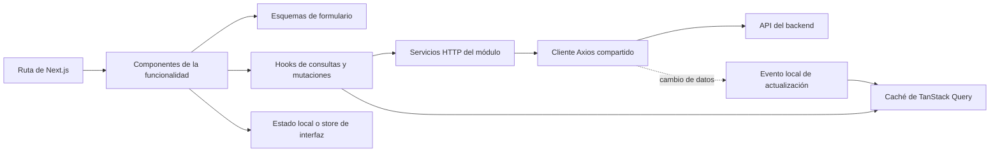

# 5. Frontend

## Clasificación de la arquitectura actual

El frontend utiliza una **organización principalmente por tipo de archivo o responsabilidad técnica** (*folder-by-type*), combinada con agrupación por módulo dentro de `components`. Las carpetas globales `services`, `hooks`, `stores`, `models`, `types` y `lib` contienen piezas de varias funcionalidades. Es una estructura híbrida, con separación de responsabilidades, pero con una funcionalidad repartida entre varias carpetas de primer nivel.

Este es un criterio de organización del código; Next.js determina además rutas y límites de ejecución, React aporta composición de interfaz y las bibliotecas de estado resuelven necesidades distintas. Ninguna de esas bibliotecas obliga a agrupar todos los servicios o todos los stores en una sola carpeta.

```text
frontend/
  app/                         rutas y layouts
  components/
    facturacion/               componentes del módulo
    inventory/                 componentes del módulo
    ui/                        componentes compartidos
  services/                    llamadas API de distintos módulos
  hooks/                       consultas y comportamiento reutilizable
  stores/                      estado de distintos módulos
  models/                      esquemas y tipos de formularios, entre otros
  types/                       contratos de datos
  lib/                         utilidades e infraestructura común
```

Es un extracto explicativo de la estructura observada. En esta versión los esquemas de formularios se encuentran, por ejemplo, en `models/invoice.model.ts`; no hay que interpretar la referencia a «schemas» de la retrospectiva como una carpeta global existente con ese nombre.

## Cómo colaboran las piezas



El diagrama representa una colaboración frecuente, no una cadena obligatoria para cada pantalla. Hay consultas que llaman al cliente HTTP directamente desde un hook. La ubicación física en carpetas y el sentido de las dependencias son aspectos distintos: dividir archivos por tipo no garantiza bajo acoplamiento.

## Base y estructura

La interfaz utiliza Next.js 16 con App Router, React 19 y TypeScript. Las rutas privadas viven bajo un grupo de rutas que comparte un diseño con barra lateral, proveedor de autenticación y proveedor de consultas. Las pantallas cubren panel, inventario, movimientos, documentos, órdenes de producción, clientes, facturas, orígenes, productos, almacenes y usuarios. Existen páginas de detalle e impresión para algunos recursos.

Los componentes se agrupan por área funcional. La capa `services` encapsula llamadas a la API; `types` y `models` describen datos usados por la interfaz. Formularios emplean React Hook Form y Zod en partes del proyecto. La presentación usa Tailwind CSS y componentes basados en Radix; Recharts se utiliza en paneles analíticos. Las vistas contemplan escritorio y móvil.

## Estado y datos remotos

| Necesidad | Mecanismo observado |
| --- | --- |
| Sesión actual y token de acceso | Store de Zustand en memoria. |
| Renovación de sesión | Cookie de renovación y cliente de refresh. |
| Consultas y caché | TanStack Query. |
| Filtros del panel | Parámetros de URL validados al leerlos. |
| Estado local de inventario y tarjetas | Stores de Zustand y estado de componentes. |
| Formularios y validación | React Hook Form, Zod y validación de API. |

Un cliente Axios central configura la URL del backend, envía credenciales y adjunta el token de acceso. Ante una respuesta 401 intenta renovar el acceso y coordina solicitudes concurrentes para no lanzar múltiples renovaciones simultáneas. Después de escrituras relevantes emite un evento local que invalida consultas analíticas. El panel también puede refrescar al recuperar el foco y periódicamente; el intervalo observado para sus datos principales es de un minuto.

## Acceso a rutas

Un `proxy` de Next.js comprueba la presencia de la cookie de renovación y el rol para redirigir en navegación. La tabla de rutas permitidas cambia según el rol: por ejemplo, el gestor accede a órdenes de producción, mientras usuarios con otros roles ven áreas adicionales. El proveedor de autenticación restablece la sesión en el navegador mediante renovación y consulta del usuario actual. Estas comprobaciones hacen más clara la navegación; la API vuelve a autenticar y autorizar cada operación.

## Diseño del panel

El panel ofrece tres áreas: inventario, producción y facturación. En inventario muestra saldos físicos, compromisos y disponibilidad, con búsqueda, filtros por catálogo/ubicación/origen/atributos y detalle de variantes. La vista de comparación permite observar varios conjuntos filtrados. Producción muestra evolución, órdenes y mermas; facturación muestra cantidades emitidas, despachadas y pendientes, con acceso a facturas y conduces. La selección de pestaña, período y algunos filtros se conserva en la URL; el estado leído de la URL se valida antes de usarlo.

Los datos analíticos se calculan en el backend. La interfaz presenta y explora resultados; no mantiene una fórmula paralela para decidir saldos físicos. La disponibilidad del panel es informativa y debe mostrarse como tal.

## Impresión y documentos

El proyecto incluye vistas de impresión y generación de PDF para documentos y tarjetas. La exportación de una tarjeta obtiene sus datos desde un endpoint específico; la interfaz prepara la presentación final. Antes de publicar capturas o PDFs hay que sustituir datos operativos por ejemplos ficticios.

## Decisiones que influyen en la experiencia

- La URL de la API pública se incorpora al bundle durante la construcción del frontend; un cambio de dominio requiere reconstruir esa imagen.
- La caché mejora la navegación, mientras la invalidación tras escrituras reduce el riesgo de mostrar métricas obsoletas.
- La interfaz puede mostrar un saldo filtrado por origen junto a reservas globales. Esta diferencia debe permanecer visible para evitar interpretaciones erróneas.
- La cookie de rol orienta rutas; los permisos del servidor son la fuente de autoridad.

## Patrones y mecanismos observados

### Composición de componentes y proveedores

**Evidencia:** el layout privado compone `AuthProvider`, `QueryProvider`, barra lateral, ventana de tarjetas y contenido de las rutas. Los componentes reciben y renderizan contenido mediante composición.

**Ventaja:** la estructura común y los recursos del árbol de interfaz no tienen que reconstruirse en cada página. El proveedor de consultas define una caché compartida para sus descendientes.

**Coste:** el orden, ámbito y ciclo de vida de los proveedores influyen en todas las pantallas que envuelven. Ubicar un recurso demasiado arriba puede ampliar su alcance sin necesidad. Usar proveedores no implica por sí mismo una arquitectura formal de inyección de dependencias.

### Hooks personalizados como unidades reutilizables de comportamiento

**Evidencia:** los hooks de facturación reúnen consultas, mutaciones e invalidaciones. Por ejemplo, una creación de factura invalida la familia de consultas de facturas.

**Ventaja:** las pantallas pueden consumir una operación sin repetir sus detalles de consulta y actualización de caché.

**Coste:** las claves de consulta y las dependencias se convierten en parte del contrato del hook. Un hook excesivamente amplio puede ocultar demasiados efectos. React aclara que un hook personalizado comparte lógica; el estado compartido depende de mecanismos como una caché, un contexto o un store, no del mero hecho de llamar al mismo hook. [Hooks personalizados en React](https://react.dev/learn/reusing-logic-with-custom-hooks).

### Servicios HTTP como fachada de acceso a la API

**Evidencia:** funciones como obtener o crear facturas encapsulan rutas y peticiones sobre el cliente Axios compartido. Puede describirse como una **fachada de acceso**: la pantalla usa nombres de operaciones en vez de construir cada petición.

**Ventaja:** concentra los detalles de transporte de esas operaciones y ofrece un lugar para tratar respuestas o errores.

**Coste:** los servicios siguen vinculados a contratos del backend; devolver un tipo de TypeScript no valida automáticamente el JSON recibido. La existencia de funciones de servicio no demuestra que haya puertos y adaptadores de una arquitectura hexagonal.

### Interceptores y coordinación de renovación

**Evidencia:** el cliente Axios adjunta el token y maneja respuestas 401. El cliente de renovación reutiliza una promesa en curso para que varias llamadas esperen el mismo resultado. Es una técnica de deduplicación de trabajo concurrente, habitualmente llamada *single flight*.

**Ventaja:** reduce duplicación de autenticación en cada servicio y coordina peticiones concurrentes ante una sesión que requiere renovación.

**Coste:** un cambio en el interceptor puede afectar toda la aplicación. Deben mantenerse claros los límites de reintento y las rutas de autenticación excluidas. La centralización es infraestructura compartida; no basta para afirmar un patrón Singleton formal.

### Notificación local para invalidación de consultas

**Evidencia:** el cliente HTTP emite el evento `rucair:data-changed` tras ciertas escrituras y el proveedor de consultas escucha para invalidar la analítica. Es un mecanismo de publicación y suscripción dentro del navegador, comparable a Observer.

**Ventaja:** una pantalla puede provocar una actualización del panel sin importar sus componentes.

**Coste:** los emisores y receptores quedan conectados mediante un nombre de evento y una convención de rutas. Esa dependencia es menos visible que una llamada directa. El mecanismo no es una notificación entre usuarios, un WebSocket ni una sincronización con otros navegadores.

### Estado remoto, estado de interfaz y validación

TanStack Query gestiona resultados remotos; Zustand y el estado local conservan sesión, selección, filtros o ventanas; React Hook Form y Zod se ocupan de formularios en las partes que los usan. Separar esas responsabilidades facilita identificar quién posee cada dato. El coste está en mantener coherentes filtros persistidos, estado de URL, caché y formularios. Copiar sin necesidad un listado remoto a un store añadiría una segunda representación que sincronizar.

## Ventajas de la organización actual

- **Inicio accesible:** es sencillo saber dónde buscar un servicio HTTP, un esquema o un store por su tipo.
- **Infraestructura visible:** cliente HTTP, componentes UI y utilidades comunes tienen ubicaciones reconocibles.
- **Responsabilidades separadas:** un formulario no necesita contener toda la implementación de transporte o caché.
- **Agrupación parcial por negocio:** las subcarpetas de componentes ya ofrecen un primer punto de entrada por módulo.

Estos beneficios se desprenden de la estructura. No se atribuyen al autor como una motivación histórica confirmada al iniciar el proyecto.

## Costes observados durante el crecimiento

El autor señala que, al aumentar el proyecto, trabajar en una funcionalidad exigía navegar entre carpetas globales con muchos archivos: esquema, servicio, componentes y store estaban separados. La organización seguía distinguiendo responsabilidades técnicas, pero reunía peor las piezas que cambiaban por una misma necesidad de negocio.

Esto describe **dispersión del cambio y falta de proximidad entre piezas relacionadas**. Modificar varios archivos no es, por sí solo, un defecto: añadir un campo editable puede requerir actualizar formulario, contrato y validación en cualquier arquitectura. El problema práctico fue el coste de localizarlos, entender sus dependencias y comprobar que el cambio estaba completo.

Conviene distinguir dos conceptos:

- **Cohesión:** cuánto comparten propósito las piezas de un módulo. Agrupar facturación con sus esquemas, servicios y componentes aumenta su proximidad funcional.
- **Acoplamiento:** cuánto depende un módulo de detalles de otro. Se reduce mediante contratos y reglas de dependencia; mover archivos no basta para reducirlo.

La experiencia del autor fundamenta preferir una organización por módulos en proyectos futuros de alcance similar. No demuestra que la estructura actual sea inválida para una aplicación más pequeña ni que la nueva elimine todos los cambios distribuidos.

## Alternativa elegida para futuros proyectos

La alternativa se denomina **arquitectura por funcionalidades o módulos**, también conocida como *feature-based*, *feature folders* o agrupación por dominio. Reúne componentes, acceso a API, esquemas, hooks y estado bajo el módulo al que pertenecen, y deja fuera la infraestructura realmente compartida. El término *feature folders* se utiliza, por ejemplo, en la documentación oficial de Redux; se cita como referencia de organización, aunque Rucair utiliza Zustand. [Organización del código en Redux](https://redux.js.org/faq/code-structure/).

**Feature-Sliced Design (FSD)** es una metodología más específica que añade capas, segmentos y restricciones de importación. Una carpeta `modules/facturacion` no basta para afirmar que se está utilizando FSD. La propuesta de Rucair es una organización modular sencilla, sin adoptar formalmente esa metodología. [Introducción oficial a FSD](https://feature-sliced.design/docs/get-started/overview).

La [decisión de arquitectura frontend](10-decision-frontend-por-modulos.md) desarrolla la estructura propuesta, sus reglas, costes y una posible adopción gradual. Es una decisión para futuros proyectos documentada a partir de la experiencia del autor; no se ha aplicado una refactorización al repositorio de Rucair.

## Referencias de implementación revisadas

Se revisaron el layout privado, los proveedores, `hooks/useInvoicingQueries.ts`, `models/invoice.model.ts`, `services/invoicing.services.ts`, los stores de sesión e inventario y los clientes HTTP y de renovación. Los nombres permiten rastrear la explicación dentro del proyecto privado, sin incorporar su código fuente a esta publicación.

[Volver a la guía](../README.md) · [Leer la decisión por módulos](10-decision-frontend-por-modulos.md)
