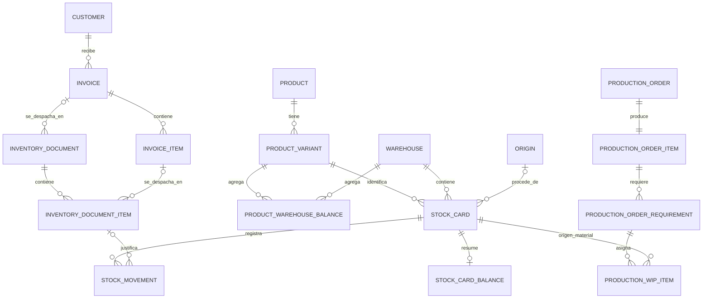

# 6. Modelo de datos

## Núcleo conceptual

El diagrama muestra relaciones conceptuales. Las cardinalidades opcionales no sustituyen los campos y validaciones de cada modelo: varios enlaces documentales solo se utilizan para ciertos tipos de documento.

## Catálogo y ubicaciones

**Product** define nombre, categoría y unidad. Las categorías actuales son materia prima (`RAW`), material para venta (`PACK`) y producto terminado (`FIN`). Las unidades incluyen unidades, gramos, kilogramos y litros. **ProductVariant** identifica presentaciones específicas y admite atributos JSON. Esto evita multiplicar columnas para cada característica de producto, aunque obliga a validar filtros y mantener convenciones de atributos.

**Warehouse** define ubicación y tipo: materia prima, producción en proceso (`wip`) o producto terminado. **ProductWarehouseBalance** guarda una cantidad por variante y almacén; la pareja tiene restricción única. Es un resumen de lectura, distinto del detalle por tarjeta.

## Inventario y lotes

**Origin** describe la procedencia como proveedor o contenedor. Su fecha puede faltar y el registro admite borrado lógico. **StockCard** enlaza variante, almacén y origen opcional, además de código y campos administrativos heredados. También admite borrado lógico. El origen especifica procedencia, pero no es por sí mismo un lote único; el modelo de tarjeta no tiene restricción única sobre variante, almacén y origen.

**StockMovement** guarda tarjeta, tipo (`in`, `out` o `waste`), fecha, cantidad positiva, saldo posterior, línea documental opcional y marca de reversión. Un movimiento pertenece a una tarjeta y puede apuntar a una línea de documento. **StockCardBalance** guarda un saldo por tarjeta, con relación uno a uno y restricción de no negatividad. La tarjeta, su saldo y sus movimientos responden preguntas diferentes: identidad física, estado actual y explicación histórica.

## Documentos

**InventoryDocument** es la cabecera de una operación: tipo, número opcional, fecha, autor, estado de cancelación y referencias opcionales a almacén destino, origen, orden o factura. **InventoryDocumentItem** guarda variante, cantidad, tipo de movimiento, descripción y, en despachos, la línea de factura. Los tipos actuales son recepción, salida, merma, ajuste, devolución, informe de producción y conduce. La vinculación `StockMovement → InventoryDocumentItem` admite varios movimientos por línea; no es una relación uno a uno.

## Producción

**ProductionOrder** representa la orden, con código único, almacén fuente, fábrica, estado, autor, cliente opcional y fecha de finalización. **ProductionOrderItem** es el objetivo de producto terminado; la implementación actual permite uno por orden. **ProductionOrderRequirement** expresa variante de insumo, cantidad requerida y cantidad ya extraída. **ProductionWipItem** registra extracciones por requisito desde tarjetas concretas, con cantidad, cantidad consumida y secuencia. Este último modelo conserva la referencia a la procedencia original cuando el material entra en fábrica.

## Clientes y facturas

**Customer** identifica al destinatario comercial. **Invoice** tiene número único, cliente, autor, fecha y estado. **InvoiceItem** enlaza factura y variante, cantidad facturada y cantidad despachada acumulada; la pareja factura + variante es única. Un documento tipo conduce referencia la factura y sus líneas referencian las líneas facturadas. Esa separación permite varios despachos parciales de una misma factura.

## Usuarios y permisos

**User_Custom** extiende el usuario de Django con un rol y permisos explícitos. Los roles son administrador, almacenero, usuario, gestor y contadora. Las relaciones de autor conservan quién emitió órdenes, documentos y facturas.

## Saldos y fuente de verdad

| Dato | Granularidad | Uso |
| --- | --- | --- |
| `StockMovement` | Evento de una tarjeta | Reconstruir y auditar cambios válidos. |
| `StockCardBalance` | Tarjeta | Consultar existencia física detallada. |
| `ProductWarehouseBalance` | Variante + almacén | Consultar total agregado en una ubicación. |
| `InvoiceItem.quantity_dispatched` | Línea de factura | Consultar avance comercial sin sumar conduces en cada vista. |
| `ProductionWipItem` | Extracción desde tarjeta | Relacionar material en proceso con requisito y procedencia. |

Los saldos materializados requieren que cada operación de escritura y reversión actualice todas las representaciones afectadas. El panel compara cantidades como señal de conciliación; una alerta no modifica datos automáticamente. Los campos numéricos principales usan decimales con dos posiciones para cantidades; los productos en unidades exigen enteros en los flujos de inventario revisados.
