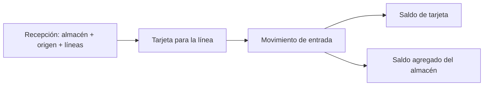
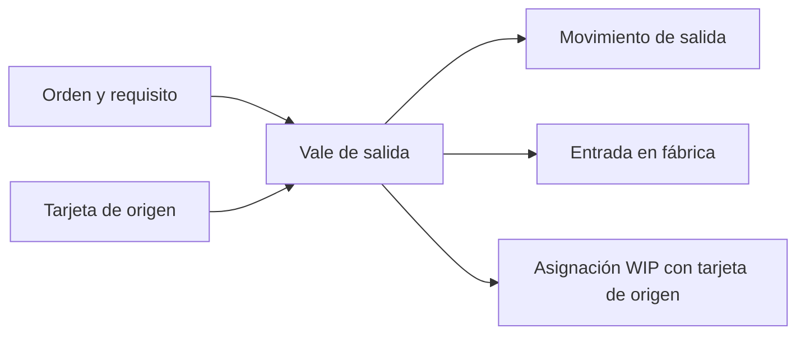
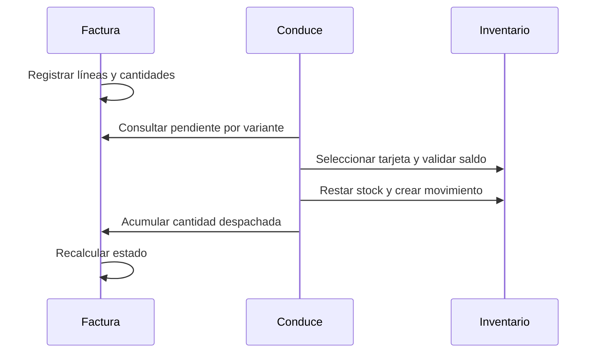

# 7. Flujos de negocio

Las secuencias expresan la intención operativa y las relaciones persistidas. Algunas variantes del flujo tienen servicios y validaciones propias; para contratos exactos se debe consultar la API de la versión privada correspondiente.

## 1. Recepción de material

La recepción exige almacén destino y origen. El servicio crea documento y líneas en una transacción; por cada línea crea una tarjeta, saldo inicial y movimiento de entrada, y suma la cantidad al balance de la variante en el almacén. El hecho de crear una tarjeta por línea permite que existan varias tarjetas con la misma variante, almacén y origen. La cancelación comprueba que quede saldo suficiente para revertir la entrada; después ajusta saldos, marca movimientos como revertidos y cancela el documento.

## 2. Extracción para producción

Una orden define producto final y requisitos. Un vale de salida elige la tarjeta de materia prima, valida cantidad y saldo, resta del almacén de origen, añade la cantidad al almacén de producción en proceso y genera los movimientos correspondientes. La asignación WIP guarda qué tarjeta de origen satisfizo qué requisito y cuánto se extrajo. Una orden puede reunir extracciones parciales desde tarjetas diferentes. La cantidad ya extraída se acumula en el requisito.

La existencia física en fábrica y la referencia al lote de origen se representan en lugares distintos: saldo de la tarjeta WIP y asignación de producción. Esta distinción evita interpretar la tarjeta WIP como si siempre fuera exclusiva de una procedencia.

## 3. Producción terminada y devolución

El informe de producción terminada se vincula a una orden y registra el producto obtenido en el almacén de destino, con los ajustes correspondientes al material en proceso. Los servicios controlan la cantidad producida y el material consumido. La fecha de finalización de una orden se registra cuando su estado pasa a completada y se limpia al reabrirla.

Si se devuelve material no consumido, el documento de devolución resta de fábrica y restaura la existencia en una tarjeta del almacén de origen, manteniendo la relación con la extracción. La cancelación de una orden con WIP no consumido contempla generar la devolución antes de cerrar la orden.

## 4. Factura y despacho parcial

La factura registra una cantidad por variante. Cada despacho selecciona una tarjeta concreta y comprueba que la variante esté facturada, que la cantidad no supere el pendiente y que haya stock físico. Los movimientos pueden agruparse en un documento de despacho por factura y fecha. La línea documental acumula cantidad; una señal recalcula el total despachado de la línea de factura a partir de conduces no anulados. El estado pasa de pendiente a parcial o completo según el avance de todas las líneas.

La cancelación de un despacho debe reflejar tanto el saldo físico como el acumulado comercial. Los servicios de reversión marcan los movimientos y el documento según el caso; el recálculo de factura responde a los cambios documentales.

## 5. Ajustes, mermas y cancelaciones

Los ajustes y mermas son documentos con servicios específicos. Las cancelaciones dependen del tipo de documento o movimiento: no basta invertir aritméticamente cualquier fila, porque una salida a fábrica, una recepción y un conduce afectan relaciones distintas. El sistema conserva el movimiento original con `is_reversed` y ajusta los saldos dentro de una transacción. Hay validaciones para evitar saldos negativos o cancelar operaciones incompatibles con el estado actual.

## 6. Lectura del panel

La consulta de inventario toma existencias de tarjetas activas y separa fábrica de otros almacenes. A estas cantidades suma los requisitos de producción pendientes y los pendientes de facturas activas, siempre por variante. El resultado distingue stock físico, reservado, disponible y faltante. Un filtro de almacén u origen acota la existencia visualizada, mientras los compromisos siguen siendo globales. La vista muestra esta diferencia expresamente para no atribuir reservas a un lote sin datos que lo sustenten.
