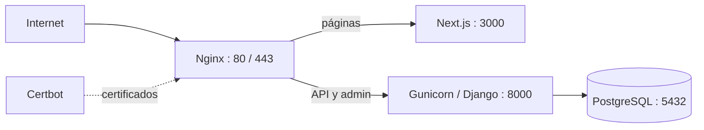

# 8. Despliegue, operación y calidad

## Topología definida

Docker Compose define servicios separados para PostgreSQL, Django/Gunicorn, Next.js, Nginx y Certbot. PostgreSQL utiliza un volumen persistente. Django y Next.js solo exponen sus puertos a la red interna de Compose; Nginx publica los puertos HTTP y HTTPS. Certbot comparte los directorios de certificados y desafío web con Nginx. Un Nginx temporal responde al desafío inicial antes de activar TLS.

Las migraciones no se ejecutan automáticamente al reiniciar el servidor: existe un servicio de herramientas y un paso explícito de migración. El contenedor del backend espera conectividad de base de datos, recolecta estáticos y después inicia Gunicorn. El frontend se compila en modo `standalone`; la URL pública de API queda incorporada durante ese build.

## Configuración y seguridad

La configuración productiva exige clave de aplicación, hosts autorizados, orígenes CSRF y conexión de base de datos definidos fuera del código. En el contenedor de producción `DEBUG` queda desactivado. Nginx termina TLS y envía al backend la información del esquema original; Django activa redirección HTTPS, cookies seguras, HSTS y cabeceras de seguridad. La aplicación sirve API y frontend bajo el mismo origen público en la topología prevista.

Este documento omite nombres y valores concretos de variables, direcciones, secretos y datos del cliente. La configuración privada debe administrarse en el entorno de despliegue, nunca en el repositorio público de documentación.

## Entrega continua

La configuración CI del proyecto privado ejecuta comprobaciones del backend, cambios de migración pendientes y pruebas; en frontend instala dependencias, aplica lint y construye la aplicación. El flujo de despliegue vuelve a verificar antes de actualizar un VPS mediante SSH. La actualización construye imágenes, ejecuta migraciones de forma explícita, levanta servicios y verifica Django. La activación automática de despliegue depende de una variable de control después del primer despliegue manual.

Estos son pasos **definidos en archivos de automatización**. Esta revisión no confirma ejecuciones recientes ni el estado de un servidor real.

## Copias de seguridad y recuperación

El proyecto incluye scripts para respaldar PostgreSQL. El diseño de despliegue coloca la base en un volumen persistente. La guía interna prescribe copias periódicas y prueba de restauración en un entorno separado. La persistencia del volumen no sustituye un backup externo; tampoco se considera demostrada la recuperación hasta ejecutar una restauración de prueba.

## Pruebas observadas

El backend contiene pruebas por módulos de productos, almacenes, inventario, documentos, producción, facturación y analítica. Entre los casos revisados hay extracciones parciales, disponibilidad por variante, reservas, filtros y unidades del panel, cancelaciones y despachos. La CI construye el frontend y ejecuta lint. No se ejecutó una batería nueva para redactar esta documentación, porque el trabajo fue de lectura y no modificó la aplicación.

## Observabilidad y límites operativos

Gunicorn envía registros de acceso y error a la salida del contenedor; los servicios tienen comprobaciones de salud. El panel incluye avisos de diferencias de saldo, que requieren investigación humana. No se observó en la topología revisada una plataforma externa de métricas, trazas o alertas; no se afirma que exista fuera del repositorio. La analítica compone resultados de consultas operativas y podría necesitar medición y optimización adicional si el catálogo o el historial crecieran mucho.
