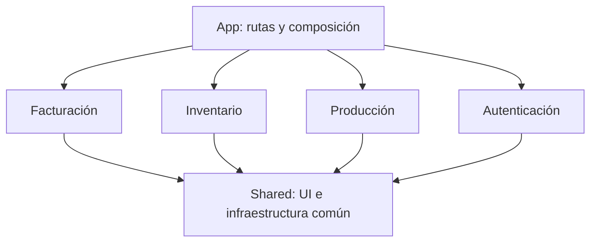

# 10. Decisión de arquitectura: frontend por módulos

**Estado:** preferencia del autor para futuros proyectos; propuesta de organización ilustrativa. **Fecha:** 15 de octubre de 2026. **Alcance:** estructura y dependencias del frontend. El repositorio original de Rucair conserva su implementación actual.

## Contexto: lo aprendido al construir Rucair

El autor describe una dificultad que apareció con el crecimiento del producto: una misma funcionalidad estaba distribuida entre carpetas globales de servicios, esquemas, componentes, hooks y stores. Trabajar en ella requería recorrer directorios con archivos de varios módulos y reconstruir mentalmente qué piezas le pertenecían.

El aprendizaje se puede expresar así: **separar responsabilidades técnicas es útil, y reunir las piezas que cambian por una misma necesidad de negocio mejora la navegación y la comprensión del cambio**. La decisión propuesta conserva componentes, servicios y estado como responsabilidades distintas, pero sitúa sus implementaciones específicas dentro de cada módulo.

No hay mediciones de tiempo de desarrollo antes y después de una migración. La dificultad de navegación procede del testimonio del autor; los beneficios futuros son expectativas razonadas, no resultados ya medidos en Rucair.

## Nombre del enfoque

Se trata de una **arquitectura frontend por funcionalidades o módulos**: *feature-based architecture*, *feature folders* o agrupación por dominio. En esta propuesta, inventario, producción y facturación son módulos amplios; dentro pueden existir funcionalidades más pequeñas como emitir factura o registrar despacho. La documentación de Redux utiliza el término *feature folders* para agrupar código de una misma funcionalidad o dominio. El criterio de agrupación puede utilizarse sin adoptar Redux. [Referencia de organización](https://redux.js.org/faq/code-structure/).

También puede describirse como **colocación por módulo**: proximidad de los archivos relacionados. Esa proximidad no sustituye las reglas de acceso a sus detalles internos.

Feature-Sliced Design es una opción relacionada, con un modelo más prescriptivo de capas y dependencias. Aquí se elige una estructura modular simple. Adoptar FSD exigiría seguir y justificar sus reglas adicionales; no se atribuye esa metodología a la implementación actual ni a este árbol ilustrativo. [Conceptos de FSD](https://feature-sliced.design/docs/get-started/overview).

## Estructura propuesta

El siguiente árbol es un ejemplo de diseño para un proyecto futuro, no código extraído de la aplicación ni una estructura ya creada en Rucair:

```text
src/
  app/                         rutas, layouts y composición de módulos
  modules/
    facturacion/
      components/              formulario, listado, detalle
      services/                operaciones HTTP de facturación
      hooks/                   consultas, mutaciones e invalidación
      schemas/                 validación de formularios del módulo
      stores/                  estado de interfaz, si es necesario
      types/                   contratos propios del módulo
      lib/                     lógica auxiliar con nombre y propósito
      public.ts                exportaciones estables para consumidores
    inventario/
      components/
      services/
      hooks/
      schemas/
      types/
    produccion/
      ...
    autenticacion/
      ...
  shared/
    ui/                        botones, diálogos y primitivas reutilizables
    http/                      transporte HTTP y errores comunes
    lib/                       utilidades genéricas con propósito concreto
    types/                     contratos técnicos compartidos
```

Cada módulo crea solo las subcarpetas que necesita. Un formulario pequeño no requiere automáticamente un store, una carpeta de utilidades y varias capas. `lib` y `utils` son convenciones de nombres; tener ambas sin un criterio claro podría reproducir la ambigüedad que se pretende reducir.

## Reglas que hacen efectiva la modularidad

### 1. Dependencias explícitas



Este es el objetivo de dependencias propuesto. `shared` no importa módulos de negocio. `app` puede componerlos. Un módulo no accede libremente a los archivos internos de otro: usa un contrato público deliberado o deja la coordinación en la capa de composición.

Por ejemplo, una pantalla de despacho puede coordinar selección de inventario y pendientes de factura. Esa relación de negocio seguirá existiendo aunque se reorganicen carpetas. La propuesta exige decidir dónde vive esa coordinación para evitar dependencias circulares entre los módulos.

### 2. Contratos públicos pequeños

Un módulo expone los componentes, tipos u operaciones que sus consumidores necesitan, sin exportar todo su contenido. Esto permite modificar el interior con menos impacto externo. Una API pública de módulo se refiere aquí a exportaciones de código, no a un endpoint HTTP.

En Next.js se deben preservar además los límites entre código de servidor y navegador. Conviene evitar una exportación global que mezcle indiscriminadamente utilidades del servidor con hooks o stores del cliente. Cuando sea necesario, esos puntos de entrada tendrán contratos separados.

### 3. Infraestructura compartida sin dependencias ocultas

En la implementación actual, el cliente HTTP conoce el store de sesión. Si el futuro cliente HTTP vive en `shared/http` y el store en `modules/autenticacion`, trasladar ambos archivos sin cambiar esa relación introduciría una dependencia ascendente de `shared` hacia un módulo.

Una solución posible es que la composición configure el transporte con una función para obtener o renovar la credencial, manteniendo el contrato técnico separado de los detalles del store. Es una decisión a tomar al implementar la propuesta; el cambio de carpetas por sí solo no la resuelve.

### 4. Estado con un propietario claro

Los datos remotos se consultan y actualizan mediante la caché de consultas. El estado de una ventana o selección permanece local o en un store del módulo si necesita compartirse entre sus componentes. Los esquemas del formulario pertenecen a la funcionalidad que los valida. El estado de URL mantiene el contexto que deba conservarse en navegación.

La organización modular no exige un store por módulo ni copiar respuestas de API a Zustand. Primero se define quién posee el dato y qué vida útil necesita; después se escoge su ubicación.

### 5. Compartir cuando haya una necesidad real

Un botón o un cliente HTTP son candidatos naturales a infraestructura común. Una regla sobre cantidades pendientes de factura sigue perteneciendo al dominio de facturación aunque la consuma una pantalla de despacho. Esa regla puede exponerse mediante un contrato del módulo; no necesita convertirse en una utilidad genérica de `shared`.

Dos funciones parecidas no necesariamente representan el mismo concepto. Extraer una abstracción compartida demasiado pronto puede vincular cambios que deberían seguir siendo independientes.

## Ejemplo de impacto: ampliar una factura

Con la organización actual, añadir un campo editable puede llevar al esquema de `models`, al contrato de `types`, al servicio de `services`, al hook de `hooks` y al formulario de `components/facturacion`. Cada pieza cumple una función distinta, pero la exploración cruza varias carpetas globales.

Con la propuesta, las piezas específicas de esa factura se localizarían en `modules/facturacion`. Es probable que sigan cambiando varios archivos: la validación y la presentación continúan teniendo responsabilidades diferentes. La mejora buscada es encontrar el conjunto, entender su alcance y revisar el cambio desde un punto de entrada cercano al negocio.

## Ventajas esperadas

- **Mayor cohesión por funcionalidad:** los archivos que responden al mismo cambio quedan próximos.
- **Navegación más directa:** se empieza por el módulo de negocio y se profundiza en sus detalles técnicos.
- **Responsabilidad más visible:** resulta más fácil identificar dónde pertenece una validación, un estado o una operación.
- **Revisión más enfocada:** el diff de una funcionalidad puede concentrarse en un módulo, salvo contratos o componentes compartidos afectados.
- **Refactorización interna más contenida:** una API pública pequeña reduce el número de consumidores que dependen de rutas internas.

## Costes y desventajas

- **Hay que diseñar los límites:** decidir si clientes, facturas y despachos pertenecen a uno o varios módulos requiere criterio de negocio.
- **Puede haber duplicación temporal:** compartir demasiado pronto o demasiado tarde tiene costes; no existe una regla de carpetas que resuelva ambos casos.
- **Los módulos pueden crecer demasiado:** una carpeta por dominio necesita nuevas divisiones si concentra demasiadas funcionalidades.
- **Persisten los cambios transversales:** autenticación, permisos, UI común y contratos de API pueden afectar varios módulos.
- **La disciplina es necesaria:** imports a archivos internos y dependencias circulares pueden destruir la encapsulación aunque el árbol parezca ordenado.
- **Una migración tiene coste:** mover archivos cambia imports y puede afectar límites de ejecución, pruebas o caché. La reorganización no promete mejorar rendimiento de ejecución por sí sola.

## Si se decidiera adoptarla en Rucair

La decisión del autor se refiere a proyectos futuros. Una eventual migración de Rucair podría hacerse módulo por módulo, manteniendo el comportamiento existente:

1. Elegir una funcionalidad acotada y enumerar sus componentes, contratos, esquemas y dependencias.
2. Reunir sus piezas internas y definir las exportaciones consumidas desde fuera.
3. Mantener compartida únicamente la infraestructura que realmente tenga varios consumidores.
4. Revisar los límites servidor/cliente, las claves de caché y la coordinación con otros módulos.
5. Verificar el flujo afectado y las comprobaciones existentes de tipado, lint y compilación antes de continuar.

No se propone comenzar reescribiendo toda la aplicación. El criterio de éxito sería que una funcionalidad resulte más fácil de localizar y modificar, con dependencias más claras y el mismo comportamiento observado.

## Aprendizaje documentado

La experiencia del autor muestra que una estructura clara por tipo al inicio puede perder comodidad cuando crecen las funcionalidades. Para un próximo proyecto de alcance similar, su preferencia es **organizar primero por módulo de negocio y después por responsabilidad técnica**, manteniendo compartidas las piezas que realmente cruzan módulos.

[Volver a frontend](05-frontend.md) · [Volver a la guía](../README.md)
